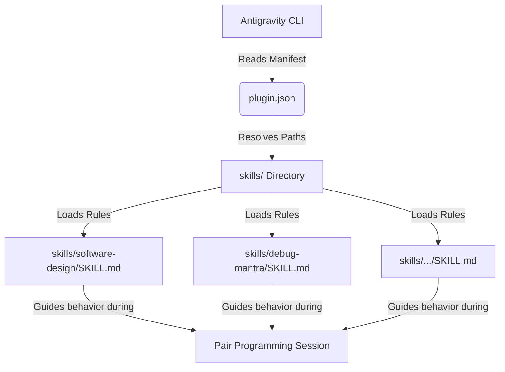
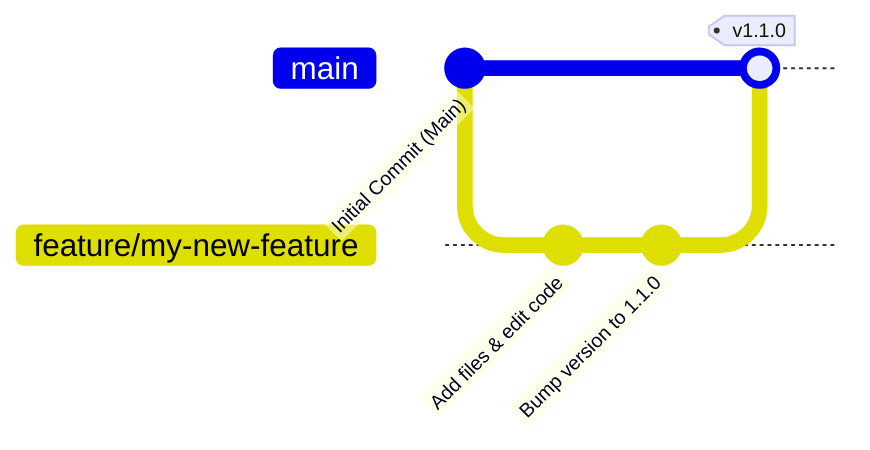

# 🌌 Apicha Skills (Antigravity Agent Extension)

[](https://github.com/google-deepmind)
[](#-interactive-skill-catalog)
[](#-step-by-step-github-branching-workflow-ภาษาไทยenglish)

A collection of 12 custom, advanced engineering and productivity skills designed to run within the **Antigravity CLI** agent environment. These skills guide the AI's pair-programming behavior, enforcing strict Software Development Life Cycle (SDLC) phases, robust system design, safe refactoring checklists, post-mortems, and a self-evolving feedback loop.

---

## ⚡ Quick Start for Newcomers

1. **Describe your goal in plain English (or Thai)** — the Antigravity agent scans your prompt and automatically selects the most appropriate skill to assist you.
2. **Prefix with a Slash Command** (e.g., `/software-design <requirement>`) to explicitly force-load a specific skill and trigger its constraints.
3. **Automate Git** — you don't need to type raw git commands. Simply tell the AI to `"Save a checkpoint"` or `"Roll back since last commit"`.
4. **Follow the SDLC Phases** — start at Phase 1 (Design), approve it, and then proceed forward. Avoid skipping directly to code generation.

---

## 📂 Repository Layout & Architecture

Skills live under the `skills/` directory. Each skill is self-contained in its own directory containing a `SKILL.md` (which starts with YAML frontmatter specifying its `name` and `description`) along with any helper scripts or template resources.

```
apicha-skill/
├── plugin.json                 # Core plugin manifest loading the skills
├── Readme.md                   # You are here!
├── scripts/                    # Platform link/list scripts & helper utilities
│   ├── link-skills.ps1         # Junction creation script for Windows
│   ├── link-skills.sh          # Symlink creation script for macOS/Linux/WSL
│   └── extract-feedback.py     # Log parser for the self-evolution loop
├── references/                 # Miscellaneous schema designs & templates
└── skills/                     # Folder containing the 12 active skills
    ├── code-refactoring/       # Improves structure under safety guards
    ├── db-migration/           # Versioned migration schema updates
    ├── debug-mantra/           # Four-mantra debugging discipline
    ├── guardrail-design/       # Destructive action fail-safes
    ├── jargon-free-error/      # Bilingual error translations
    ├── management-talk/        # Shaping tech updates for managers
    ├── post-mortem/            # Detailed root-cause analysis
    ├── runbook-generator/      # Jargon-free operator runbooks
    ├── scrutinize/             # Independent PR/diff code reviewer
    ├── self-evolution/         # Automatic rule-learning loop
    ├── software-design/        # Design-first specs & Mermaid diagrams
    └── test-writer/            # Automated test generators
```

### 🔄 How Antigravity Loads Skills
The Antigravity CLI matches instructions in the global state, using the manifest file `plugin.json` to discover active skill paths.



---

## 🛠️ Interactive Skill Catalog

Below is the complete registry of active skills. You can invoke them explicitly using their corresponding slash commands:

| Skill Name & Link | Category | Trigger Command | Trigger it when... | Do NOT use when... |
| :--- | :--- | :--- | :--- | :--- |
| **[software-design](./skills/software-design/SKILL.md)** | Engineering | `/software-design <requirement>` | Designing architectures, drawing Mermaid flows, or planning a new feature. | The feature design has already been approved — proceed to implementation. |
| **[db-migration](./skills/db-migration/SKILL.md)** | Engineering | `/db-migration <schema change>` | Modifying database tables, columns, indexes, or relations. | Design documents have not been finalized or approved. |
| **[code-refactoring](./skills/code-refactoring/SKILL.md)** | Engineering | `/code-refactoring <goal>` | Cleaning up working code to improve readability or performance. | The workspace is dirty (uncommitted changes exist). |
| **[test-writer](./skills/test-writer/SKILL.md)** | Engineering | `/test-writer <file/feature>` | Adding unit or integration test coverage to newly implemented code. | No working implementation code exists yet. |
| **[scrutinize](./skills/scrutinize/SKILL.md)** | Engineering | `/scrutinize <code/PR/plan>` | Conducting a thorough third-party review of a PR, code diff, or system design. | Basic test suites or linters are still failing. |
| **[debug-mantra](./skills/debug-mantra/SKILL.md)** | Engineering | `/debug-mantra <error/bug>` | Systematically tracing errors or debugging complex integration problems. | You have not reproduced the bug yet. |
| **[post-mortem](./skills/post-mortem/SKILL.md)** | Engineering | `/post-mortem <details>` | Writing the post-incident report after a bug is fully fixed and verified. | The bug fix is still in progress or unverified. |
| **[guardrail-design](./skills/guardrail-design/SKILL.md)** | Engineering | `/guardrail-design <actions>` | Planning safety checkpoints, limits, or confirmations for destructive user actions. | The system contains no destructive, bulk-update, or delete operations. |
| **[jargon-free-error](./skills/jargon-free-error/SKILL.md)** | Engineering | `/jargon-free-error <error>` | Writing user-facing error messages and translation catch-blocks. | The error is only logged server-side and is never visible to end-users. |
| **[self-evolution](./skills/self-evolution/SKILL.md)** | Engineering | `/self-evolution` | Session is complete and you want to analyze logs to update skill guidelines. | A task is still in progress mid-session. |
| **[management-talk](./skills/management-talk/SKILL.md)** | Productivity | `/management-talk <update>` | Shaping technical updates for leaders (JIRA, Slack, async standups, emails). | Presenting to an engineering audience who expects low-level tech details. |
| **[runbook-generator](./skills/runbook-generator/SKILL.md)** | Productivity | `/runbook-generator` | Creating user/operator-facing instructions (Thai/English) for newly deployed features. | The feature is not yet stable or is still being actively coded. |

---

## ⚙️ Setup & Local Registration

To load these skills into your local Antigravity environment, use the setup scripts. They will map the repository's skills to the Antigravity system directories.

### 🪟 Windows (PowerShell)
Run these commands in a PowerShell console:
```powershell
# 1. Link all repository skills to the Antigravity local CLI directory
.\scripts\link-skills.ps1

# 2. Verify all active links
.\scripts\list-skills.ps1
```

### 🍎 macOS / Linux / WSL (Bash)
Run these commands in your Unix shell:
```bash
# 1. Link all repository skills
./scripts/link-skills.sh

# 2. Verify all active links
./scripts/list-skills.sh
```

### 📊 Extracting Conversation Feedback & Errors
You can run the python utility manually to compile a clean summary of conversation events, user input, and tool execution failures. This script parses raw logs and feeds the `/self-evolution` loop.
```bash
python scripts/extract-feedback.py --conv-id <your-conversation-id>
```
*   **Default Output Path:** `scratch/feedback_summary.txt`
*   **Argument options:** 
    *   `--app-data-dir` (Default: `~/.gemini/antigravity-ide`) — Path to the Antigravity data folder.
    *   `--output` (Default: `scratch/feedback_summary.txt`) — Custom path to write the extracted summary.

---

## 🏗️ SDLC Workflow Timeline: IoT Machine Control Gateway

To illustrate how these skills work together, here is an end-to-end walkthrough of a typical development lifecycle using the example repository `iiot-machine-gateway`. All Git operations are handled transparently by the AI agent.

```
[Phase 1: Design] ➔ [Phase 1.5: DB Migration] ➔ [Phase 2: Code] ➔ [Phase 2.5: Test] ➔ [Phase 3: Review] ➔ [Phase 4: Refactor]
```

### 🟦 Phase 1 — Requirements & Design
*   **You say:** 
    > "/software-design I need a web-based control API to interface with our factory machines. Users should be able to send commands (START, STOP, EMERGENCY_STOP) via HTTP/WebSockets, and the system must log machine telemetry (RPM, Temperature, Current) into a database. Design this system and place it under docs/."
*   **AI Action:** Creates `docs/hardware-interface-design.md` outlining API endpoints, state transition constraints, and safety invariants. **The AI waits for your explicit approval ("Approved") before moving forward.**

### 🗄️ Phase 1.5 — Database Migration
*   **You say:** 
    > "/db-migration Create a `machine_logs` table for telemetry data (machine_id, temperature, rpm, timestamp) and a `command_audit` table to track who triggered which machine command."
*   **AI Action:** Generates structured Knex/Prisma migration scripts (with matching `up` and `down` logic), validates them locally, commits the migration files, and updates the database schema docs.

### 🟩 Phase 2 — Implementation (New Feature)
*   **You say:** 
    > "Save a checkpoint, then implement the machine command controller from docs/."
*   **AI Action:** Performs a git checkpoint commit, implements the controllers/handlers line-by-line, and commits incrementally as features pass code compilation.

### 🧪 Phase 2.5 — Testing
*   **You say:** 
    > "/test-writer Write integration tests for the command endpoint. Mock the machine gateway responses. Cover the happy path (successful START), edge cases (commands during a FAULT state), and network timeouts."
*   **AI Action:** Creates and runs a complete test suite. **If tests fail, the AI stops to resolve them before moving to review.**

### 🟨 Phase 3 — Code Review & Scrutiny
*   **You say:** 
    > "/scrutinize the machine command logic we just implemented. Is there any risk of command race conditions if two users click 'START' and 'STOP' simultaneously?"
*   **AI Action:** Conducts an objective, independent review of the files, highlights potential edge cases, and provides concrete recommendations to prevent concurrency conflicts.

### 🟧 Phase 4 — Refactoring & Clean-up
*   **You say:** 
    > "/code-refactoring Clean up the telemetry parser inside the payload decoder module. Make sure it stays safe."
*   **AI Action:** Saves a git checkpoint, refactors the parser code, runs the test suite to verify no behavior has changed, and commits the refactored code. **If tests fail, it automatically rolls back.**

---

## 🛡️ Git Safety & Recovery Commands

Tell the agent to run these instructions anytime to manage repository versions without typing raw git syntax:

> [!NOTE]
> **Visual Commit Graphs:** Whenever the agent executes any Git operation (like commit, checkout, merge, status, reset, etc.), it is required to always include a visual Git Graph diagram using a Markdown Mermaid block at the end of its response to keep the branch history and commit structures fully transparent.

| You Say... | What the Agent Does |
| :--- | :--- |
| **"Save a checkpoint"** | Runs `git add -A && git commit -m "chore: checkpoint"` |
| **"Show me what changed"** | Executes `git diff` and generates a plain-English translation summary of differences. |
| **"Roll back the last change"** | Reverts changes using `git checkout .` or `git revert HEAD`. |
| **"Undo everything since the last save"** | Executes `git reset --hard HEAD` and deletes untracked files. |
| **"Is there anything unsaved?"** | Runs `git status` and summarizes the uncommitted lines. |
| **"Which branch am I on?"** | Runs `git branch` and explains the active working branch. |
| **"There's a merge conflict, help me!"** | Locates conflicts, shows them, assists you in picking changes, and completes the commit. |

---

## 📦 Step-by-Step GitHub Branching Workflow (ภาษาไทย/English)

A comprehensive guide on creating branches, committing changes, and pushing them to GitHub safely.

### 1. Visual Workflow (แผนภาพการทำงาน)



### 2. Step-by-Step Prompts (ประโยคที่สามารถพิมพ์สั่งงาน AI ได้ทันที)

#### 🔹 Step 1: Push Project to GitHub for the First Time (อัปโหลดโปรเจกต์ขึ้น GitHub ครั้งแรก)
*   **คำสั่งที่ใช้ได้ (You say):**
    ```
    "Initialize a new Git repository for this project, create a new repository on GitHub named 'apicha-skill', and push all files to the main branch."
    ```
    *(หรือพิมพ์แบบสั้น: `"Push this project to a new GitHub repository named 'apicha-skill' for the first time."`)*
*   **การทำงานของ AI:** เริ่มต้น Git local repository ➔ เชื่อมต่อและยืนยันตัวตนกับ GitHub ➔ สร้าง Remote Repository ➔ ดำเนินการ Commit และ Push ไปยังสาขาหลัก (`main`)

#### 🔹 Step 2: Create a Feature Branch (สร้างกิ่งใหม่สำหรับพัฒนาฟีเจอร์)
*   **คำสั่งที่ใช้ได้ (You say):**
    ```
    "Create a new branch called 'feature/update-skills' and switch to it. Let's work on this branch."
    ```
    *(หรือพิมพ์แบบสั้น: `"Make a new branch named 'feature/update-skills' for our next updates."`)*
*   **การทำงานของ AI:** สร้างสาขา (branch) ย่อยและสลับหน้าต่างทำงานมาที่สาขาดังกล่าวทันที ช่วยป้องกันไม่ให้โค้ดการพัฒนาฟีเจอร์ใหม่ไปปะปนกับกิ่งหลักที่มีความเสถียรอยู่แล้ว

#### 🔹 Step 3: Bump Version & Commit (ปรับปรุงเลขรุ่นและบันทึกงาน)
*   **คำสั่งที่ใช้ได้ (You say):**
    ```
    "Update the version in plugin.json to 1.1.0, then commit all our current changes with the message 'feat: update skills and bump version to 1.1.0'."
    ```
    *(หรือพิมพ์แบบสั้น: `"Bump the project version to 1.1.0 and commit all changes on this branch."`)*
*   **การทำงานของ AI:** แก้ไขรุ่นของแอปใน `plugin.json` ➔ บันทึกความเปลี่ยนแปลงทั้งหมด (git stage and commit) พร้อมระบุข้อความอธิบายการปรับแต่งที่ชัดเจน

#### 🔹 Step 4: Merge Branch to Main & Push (รวมสาขากลับกิ่งหลักและส่งขึ้น GitHub)
*   **คำสั่งที่ใช้ได้ (You say):**
    ```
    "Switch back to the main branch, merge the changes from 'feature/update-skills', and push everything to GitHub."
    ```
    *(หรือพิมพ์แบบสั้น: `"Merge our current branch into main and push the updates to GitHub."`)*
*   **การทำงานของ AI:** สลับกลับไปที่กิ่ง `main` ➔ รวมผลลัพธ์จาก `feature/update-skills` เข้ากิ่งหลัก ➔ ดำเนินการอัปโหลดความเปลี่ยนแปลงล่าสุดทั้งหมดกลับขึ้นไปเก็บบนคลาวด์ของ GitHub

---

## 🛡️ Emergency & Recovery (การกู้คืนไฟล์เมื่อเกิดปัญหา)

หากโค้ดทำงานพังอย่างกะทันหัน หรือเกิดเหตุการณ์ไฟล์สูญหาย ไม่ต้องกังวล คุณสามารถสั่งการกู้คืนโค้ดได้ทันทีโดยใช้คำสั่งเหล่านี้:

*   **กรณีเกิดข้อขัดแย้งของโค้ด (Merge Conflict):**
    > *"There's a merge conflict in [file_name]. Show me the conflicts and help me choose which changes to keep."*
    (มีจุดชนกันของโค้ดใน [ชื่อไฟล์] ช่วยหาจุดขัดแย้งและแนะนำหน่อยว่าควรเก็บโค้ดส่วนไหนไว้)
*   **เมื่อต้องการยกเลิกการแก้ไขทั้งหมดเพื่อย้อนกลับไปจุดเซฟล่าสุด:**
    > *"I broke the code and want to restore it to the last saved checkpoint. Undo all changes since our last commit."*
    (ฉันทำโค้ดพังและต้องการถอยกลับไปจุดเซฟล่าสุด ช่วยรีเซ็ตความเปลี่ยนแปลงทั้งหมดตั้งแต่ commit ล่าสุดให้หน่อย)
*   **เมื่อเผลอลบไฟล์งานไปโดยไม่ได้ตั้งใจ:**
    > *"I accidentally deleted [file_name]. Can you recover it using Git?"*
    (ฉันเผลอลบไฟล์ [ชื่อไฟล์] ไปโดยบังเอิญ ช่วยดึงไฟล์กู้คืนผ่านประวัติ Git ให้หน่อย)