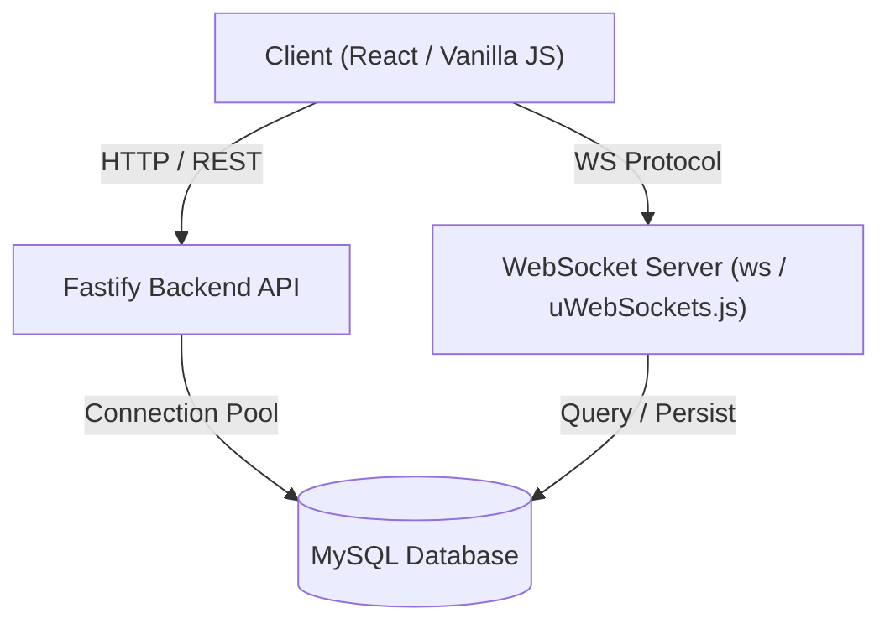
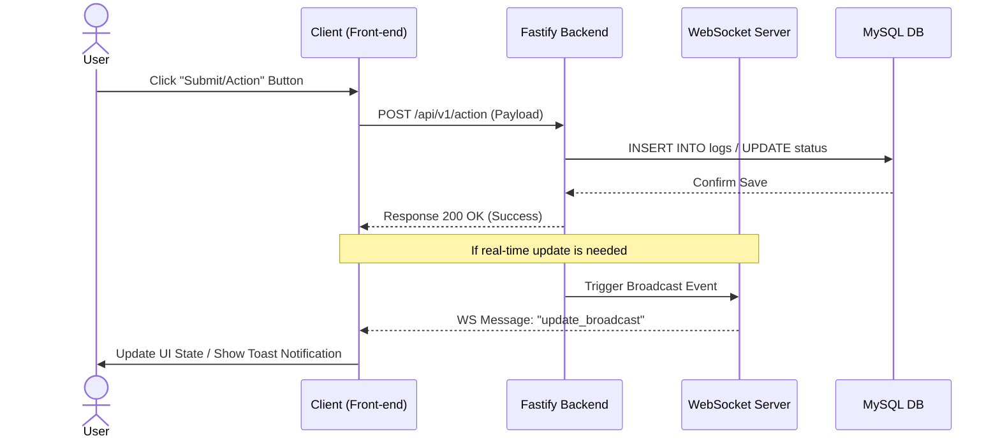

# Software Design Skill (Strict Design-First)

Always adopt a strict "Design-First" stance. Do NOT modify implementation code, create source code files, or run installation commands until the design proposal has been drafted in a `.md` file, visualized with Mermaid diagrams inside that document, and explicitly reviewed and approved by the user.

## Fixed Tech Stack & Constraints

You must strictly design the system around the following pre-approved technologies:
- **Backend API:** Fastify (Node.js REST API framework)
- **Real-time / WebSocket:** `ws` package OR `uWebSockets.js` (choose based on performance needs, but limit to these two)
- **Database:** MySQL (Relational Database only)
- **Front-end:** Must ask and clarify whether the user wants **Vanilla JavaScript** or **React** before finalizing the design.

---

## Workflow Steps

You must follow these steps in order. Do not jump to writing application code.

### Step 1: Ingestion & Clarify Front-end Stack
Analyze the user's requirements and immediately ask clarifying questions to align on design parameters:
1. **Clarify Frontend:** Ask whether the user prefers **Vanilla JavaScript** or **React**.
2. **System Boundaries & Constraints:** What external systems must this integrate with? What are the limitations or restrictions?
3. **Data & Traffic Volume:** What is the scale? (e.g., requests per second, storage size, concurrent users).

### Step 2: Create the Design Document (.md)
Write a comprehensive design document in the workspace (e.g., `docs/design_proposal.md`). The file must follow this structure:

1. **Title & Document Metadata:** Clear project/feature title, author, and date.
2. **Problem Statement & Requirements:**
   - **Functional:** Core features and system behaviors.
   - **Non-Functional:** Performance (Fastify/uWS optimizations), Scalability, and Connection handling.
3. **Proposed System Architecture:**
   - High-level overview of the architectural pattern (e.g., Layered Architecture, Clean Architecture adjusted for Fastify plugins).
   - Component responsibilities (Client, Fastify REST API, WebSocket Server, MySQL DB).
4. **Architecture & Flow Diagrams (Mermaid) - MUST INCLUDE BOTH:**
   - **System Architecture Diagram (graph TD):** To visually map out the system components, network boundaries, and connection topologies (e.g., how Fastify and WebSocket connect to MySQL).
   - **User Interaction & Data Flow Diagram (sequenceDiagram):** To map out the exact sequence of user actions (clicks/events), API requests, WebSocket messages, and database operations.
5. **Technical Stack Choices & Trade-offs:**
   - Document how Fastify, MySQL, and the chosen WS solution interact.
   - Detail connection pooling for MySQL and resource management for WebSockets.
6. **Data Models / Database Schema:**
   - Key MySQL tables, fields, types, and primary/foreign key relations (DDL/SQL format preferred).
7. **Open Questions / Feedback Points:**
   - Specific items that need the user's explicit decision.

### Step 3: Present for Review & Iterate
- Provide the user with a direct markdown file link to the design document.
- Highlight the key architectural decisions (especially how Fastify routes and WebSocket connections are structured alongside MySQL).
- Incorporate feedback, update the document, and repeat until the user explicitly says the design is approved.

### Step 4: Hand-off to Implementation
- Once approved, proceed to formulate an implementation plan, database migration steps, or task list based on the approved design.

---

## Technical Diagram Conventions

When writing Mermaid diagrams inside the markdown:
- Use double quotes `""` for node labels containing special characters, brackets, or parentheses to avoid parser syntax errors.
- Always implement **BOTH** a `graph TD` for system topology and a `sequenceDiagram` for user event/data flows.
- **Never mix multiple diagram types in a single code block.** Write them in separate, dedicated ` ```mermaid ` code blocks.
- Ensure correct sequence diagram syntax (use `participant` in singular form).

### Example Embedded Diagrams





## Target Project Structure
All designs must conform to or reference the following monorepo/directory architecture:

```text
my-app/
├── apps/
│   ├── backend/                 # Fastify API & WebSocket Server
│   │   ├── src/
│   │   │   ├── config/          # Environment variables & DB connection pool setup
│   │   │   │   ├── env.js       # Configures ENV variables (PORT, JWT_SECRET)
│   │   │   │   └── database.js  # Establishes MySQL connection pool
│   │   │   │
│   │   │   ├── plugins/         # Fastify core ecosystem extensions
│   │   │   │   ├── db.js        # Registers MySQL client as a global 'app.mysql' plugin
│   │   │   │   └── websocket.js # Initializes ws/uWebSockets.js server binding
│   │   │   │
│   │   │   ├── routes/          # Request routers split by consumer types
│   │   │   │   ├── internal/    # [Internal API] Used by our own front-end (Auth, CRUD)
│   │   │   │   ├── external/    # [External API] Third-party webhooks and public endpoints
│   │   │   │   └── websocket/   # [WS Endpoints] Connection management & real-time handlers
│   │   │   │
│   │   │   ├── services/        # Business logic & operational orchestrators
│   │   │   │   ├── user.service.js
│   │   │   │   └── integration.service.js # Coordinates outbound third-party API/WS calls
│   │   │   │
│   │   │   └── app.js           # Main application entry point registering plugins & routes
│   │   ├── package.json
│   │   └── .env
│   │
│   └── frontend/                # Client-side user interface folder
│       # (Structure will vary based on user framework choice: React vs Vanilla JS)
└── docs/                        # Project documentation repository
    ├── design_proposal.md       # Target file generated by this skill
    └── database_schema.md       # MySQL database layout description
```

## Mandatory Security Context (Zero-Trust Architecture)
Even if running inside a private company intranet, you must explicitly enforce and document the following security strategies across different entry points to ensure clear boundaries and avoid logic pollution:

1. **Internal API (`routes/internal/`): User-Centric Protection**
   - Must use **JWT (JSON Web Tokens)** or **HttpOnly Cookie Sessions** to authenticate human operators/engineers.
   - Every request must verify the user's role before accessing business services to support data auditing and log tracking ("Who changed what?").

2. **External API (`routes/external/`): Machine-to-Machine Protection**
   - Dedicated for automated third-party integrations, automated scripts, or webhooks.
   - Must strictly require an **API Key** passed in headers or a **Webhook Secret Signature Verification** (e.g., HMAC validation).
   - Must be isolated from user session logic to prevent bad automated scripts from flooding or crashing core application flows.

3. **WebSocket Endpoints (`routes/websocket/`): Pre-Flight Handshake Protection**
   - Authentication must be validated at the earliest gate: **During the HTTP Upgrade / Handshake Request**.
   - If no valid JWT token is provided, the server must **Reject the Handshake immediately (HTTP 401/403)** to save memory overhead and protect server resources from dangling unauthenticated connections.