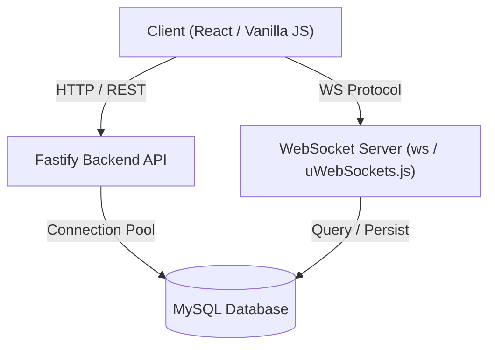
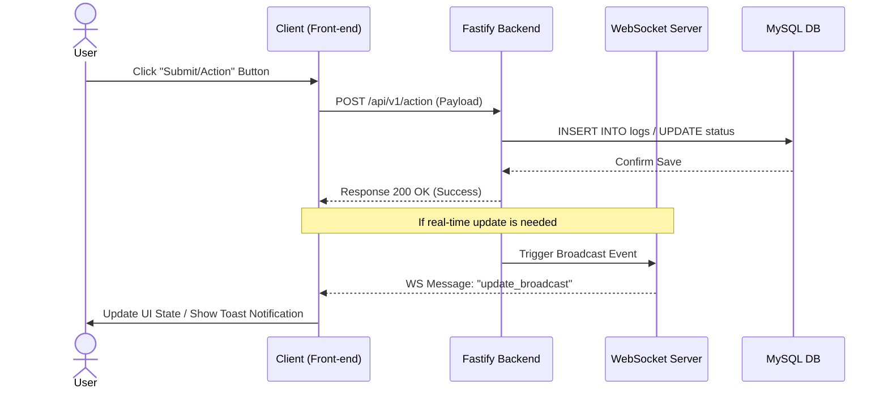

# Software Design Skill (Strict Design-First & Modular Documentation)

Always adopt a strict "Design-First" stance. Do NOT modify implementation code, create source code files, or run installation commands until the design proposal has been drafted/updated across modular `.md` files in the `docs/` folder, and explicitly approved by the user.

**Token Optimization & Anti-Scanning Invariant:**
To prevent wasting tokens on scanning large directories repeatedly:
- The markdown files under `docs/` serve as the canonical **Source of Truth** for the project's architecture, routes, database schemas, and components.
- Do NOT run project-wide grep searches or file scans on every task. Instead, read the specific design file (e.g. `docs/backend/endpoints.md`) first to identify exactly which files need to be modified.
- Update the design documentation *first* whenever requirements evolve.

## Fixed Tech Stack & Constraints

You must strictly design the system around the following pre-approved technologies:
- **Backend API:** Fastify (Node.js REST API framework)
- **Real-time / WebSocket:** `ws` package OR `uWebSockets.js` (choose based on performance needs, but limit to these two)
- **Database:** MySQL (Relational Database only)
- **Front-end:** Must ask and clarify whether the user wants **Vanilla JavaScript** or **React** before finalizing the design.

---

## Workflow Steps

You must follow these steps in order. Do not jump to writing application code.

### Step 1: Ingestion & Clarify Front-end Stack
Analyze the user's requirements and immediately ask clarifying questions to align on design parameters:
1. **Clarify Frontend:** Ask whether the user prefers **Vanilla JavaScript** or **React**.
2. **System Boundaries & Constraints:** What external systems must this integrate with? What are the limitations or restrictions?
3. **Data & Traffic Volume:** What is the scale? (e.g., requests per second, storage size, concurrent users).

### Step 2: Create or Update Modular Design Documents
Write or update the design files under the `docs/` directory, structured by components to prevent reading large, monolithic design documents:

1. **`docs/system/architecture.md` (System Topology)**
   - High-level architectural pattern (e.g. Layered Architecture, Clean Architecture adjusted for Fastify).
   - Component responsibilities (Client, Fastify REST API, WebSocket Server, MySQL DB).
   - **Both** `graph TD` (System Topology) and `sequenceDiagram` (User event/data flows) Mermaid diagrams.
   - **Authentication Boundary Map (Mandatory):** Must explicitly annotate which auth mechanism guards each boundary:
     - `routes/internal/` → protected by **JWT (`verifyToken` middleware)**
     - `routes/external/` → protected by **API Key (`verifyApiKey` middleware)**
     - `routes/websocket/` → protected by **JWT validated at HTTP Upgrade/Handshake**
2. **`docs/backend/endpoints.md` (Fastify & WebSockets Spec)**
   - API routes, method, request validation schema definitions, and response payloads.
   - WebSocket message/event names, payloads, and state cleanup rules.
   - Authentication protocols: specify **which middleware** (`verifyToken` or `verifyApiKey`) guards each route group.
   - **No RBAC in endpoint spec:** Do NOT add role guards, permission checks, or access matrices to any route definition unless the user has explicitly requested RBAC for that specific feature.
3. **`docs/frontend/components.md` (Client-side Design)**
   - View/component hierarchy and layout mapping.
   - State management strategy (React state/context or Vanilla JS custom store) and key routes.
4. **`docs/database/schema.md` (MySQL Schema Spec)**
   - Key MySQL tables, fields, data types, indexes, and primary/foreign key relations (DDL/SQL format).
   - Database migration strategy.

### Step 3: Present for Review & Iterate
- Provide the user with direct markdown file links to the updated design documents in `docs/`.
- Highlight key changes (especially network boundaries, route schemas, and database relations).
- Incorporate feedback, update the corresponding documentation files, and repeat until approved.

### Step 4: Hand-off to Implementation
- Once approved, proceed to formulate an implementation plan or task list based on the approved design files, editing only the specific source files mapped in the design.

### Step 5: Keep Documentation In-Sync (Post-Implementation Update)
- **CRITICAL INVARIANT:** Immediately after writing, modifying, or refactoring any code files, you **MUST** update the corresponding design/architecture files under `docs/` (`docs/system/architecture.md`, `docs/backend/endpoints.md`, `docs/frontend/components.md`, or `docs/database/schema.md`) to reflect the exact implementation details.
- Never let code and design diverge. If an implementation detail changed during coding (e.g., modified route paths, additional database keys, altered component props), adjust the documentation file immediately as the final step of the task before declaring it complete.

---

## Technical Diagram Conventions

When writing Mermaid diagrams inside the markdown:
- Use double quotes `""` for node labels containing special characters, brackets, or parentheses to avoid parser syntax errors.
- Always implement **BOTH** a `graph TD` for system topology and a `sequenceDiagram` for user event/data flows.
- **Never mix multiple diagram types in a single code block.** Write them in separate, dedicated ` ```mermaid ` code blocks.
- Ensure correct sequence diagram syntax (use `participant` in singular form).

### Example Embedded Diagrams





## Target Project Structure
All designs must conform to or reference the following monorepo/directory architecture:

```text
my-app/
├── apps/
│   ├── backend/                 # Fastify API & WebSocket Server
│   │   ├── src/
│   │   │   ├── config/          # Environment variables & DB connection pool setup
│   │   │   │   ├── env.js       # Configures ENV variables (PORT, JWT_SECRET)
│   │   │   │   └── database.js  # Establishes MySQL connection pool
│   │   │   │
│   │   │   ├── plugins/         # Fastify core ecosystem extensions
│   │   │   │   ├── db.js        # Registers MySQL client as a global 'app.mysql' plugin
│   │   │   │   └── websocket.js # Initializes ws/uWebSockets.js server binding
│   │   │   │
│   │   │   ├── routes/          # Request routers split by consumer types
│   │   │   │   ├── internal/    # [Internal API] Used by our own front-end (Auth, CRUD)
│   │   │   │   ├── external/    # [External API] Third-party webhooks and public endpoints
│   │   │   │   └── websocket/   # [WS Endpoints] Connection management & real-time handlers
│   │   │   │
│   │   │   ├── services/        # Business logic & operational orchestrators
│   │   │   │   ├── user.service.js
│   │   │   │   └── integration.service.js # Coordinates outbound third-party API/WS calls
│   │   │   │
│   │   │   └── app.js           # Main application entry point registering plugins & routes
│   │   ├── package.json
│   │   └── .env
│   │
│   └── frontend/                # Client-side user interface folder
│       # (Structure will vary based on user framework choice: React vs Vanilla JS)
└── docs/                        # Project documentation repository (Source of Truth)
    ├── system/
    │   └── architecture.md      # High-level architecture & Mermaid diagrams
    ├── backend/
    │   └── endpoints.md         # API route schemas, controllers, websocket events
    ├── frontend/
    │   └── components.md        # UI component tree, routes, and state
    └── database/
        └── schema.md            # MySQL database DDL and schema details
```

## Mandatory Security & Authentication Context

Every project created must strictly implement two core authentication mechanisms and adhere to the following security design constraints:

1. **Dual Core Authentication (Mandatory):**
   - **JWT (JSON Web Token):** For User-facing endpoints (Frontend / humans accessing the system via a Web App).
   - **API Key / App Credentials:** For Service-to-Service endpoints (external systems, bots, or partners pulling data automatically).

2. **No RBAC by Default (Conditional):**
   - Do **NOT** implement any roles, permission matrices, or Role-Based Access Control (RBAC) in the codebase by default.
   - RBAC must only be introduced if the user explicitly specifies: *"I want to use RBAC for this feature."*

3. **Design Philosophy:**
   - **Keep it simple:** Keep the overall authorization/authentication system as concise and simple as possible.
   - **Clear Middleware Separation:** Keep the JWT verification middleware (`verifyToken`) and the API Key verification middleware (`verifyApiKey`) completely separate.
   - **Clean Architecture:** Router setup and token payloads must remain clean, simple, and easy to read.

4. **WebSocket Endpoints (`routes/websocket/`): Pre-Flight Handshake Protection**
   - Authentication must be validated at the earliest gate: **During the HTTP Upgrade / Handshake Request**.
   - If no valid JWT token is provided, the server must **Reject the Handshake immediately (HTTP 401/403)** to save memory overhead and protect server resources from dangling unauthenticated connections.